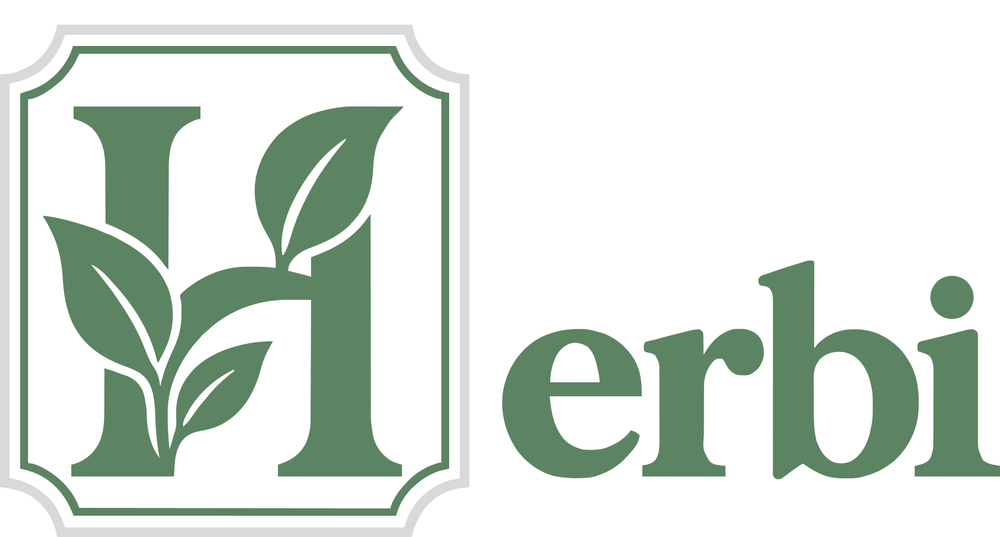
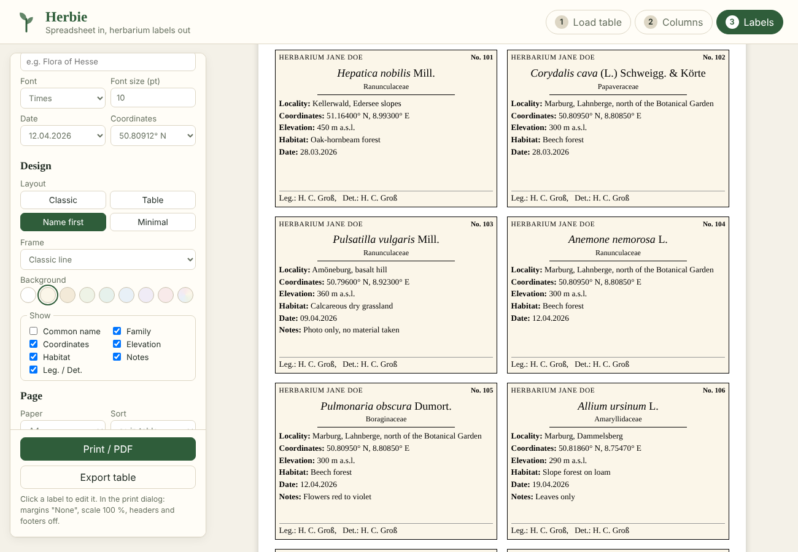

<i>Schedae ad Floram exsiccatam</i>

<h3 align="center">Herbarium labels have never been this easy.</h3>

Turn your collection spreadsheet into beautiful, print-ready herbarium labels in minutes. No installation, no account, and your data never leaves your browser.

**Pin every find exactly.** Set the precise locality of each specimen with a click on the map, search places by name, or let Herbie look up all localities and elevations at once.

**Make the labels yours, if you like.** Choose from different layouts, frames, colours and paper textures, pick the label language and decide which fields are printed and in which order. Or simply keep the defaults.

**Three steps, that's it:**

1. **Load** your Excel or CSV table
2. **Choose** what to print
3. **Print** and put the labels on your sheets

<b><a href="https://christiang4.github.io/Herbie/">Open Herbie: christiang4.github.io/Herbie</a></b>

## Features

- Reads `.xlsx`, `.xls`, `.ods` and `.csv`
- Detects columns automatically (English, German and Darwin Core names)
- Data editor with table, on/off switch per specimen and interactive map (OpenStreetMap, topographic, satellite): click to set a locality, drag the marker, search places
- Picks up coordinates written in the locality text (e.g. `Marburg, 50.8091, 8.8132`)
- Finds localities on the map from the locality text, for one specimen or all at once (only missing or overwrite all)
- Fetches elevation from the Copernicus GLO-90 terrain model via Open-Meteo, for one specimen or all at once; the source is noted and exported
- Copies coordinates to all specimens with the same locality
- Every action explains itself and asks for confirmation first
- Label language: English, German, French, Spanish, Italian, Portuguese, Dutch, Swedish, Polish, Czech or Latin (field names, compass letters, elevation unit)
- Four label layouts (Classic, Table, Name first, Minimal), frame styles (or no frame), background colours and paper textures (paper, parchment, linen, leaves, dots, ruled, grid, hatch)
- Customisable labels: header, font, size, date format (incl. Roman month), coordinate format
- Choose which fields are printed and drag them into your preferred order
- Own fields: print any extra column of your table under a name of your choice (e.g. column `col` as "Colour")
- Empty fields are left out by default, or printed as "Elevation: -" if you prefer
- Layout: A4 or US Letter, labels per page, margins, skip already used labels on a sheet
- Correct name formatting: genus and epithets in italics, authors upright
- Flags overfull labels in red
- Exports the table with the added coordinates as `.xlsx`
- Keeps your session in the browser so you can continue after reloading

## Privacy

Your table is processed locally and never uploaded. External requests are made only for:

| Purpose | Service | When |
|---|---|---|
| Excel library | cdn.sheetjs.com | on page load |
| Map tiles | OpenStreetMap, OpenTopoMap, Esri | when the map is shown |
| Place search | Nominatim (OpenStreetMap) | on click, with your search text |
| Elevation | Open-Meteo | on click, with the specimen's coordinates |

## Usage

1. **Load table**: drop your Excel file onto the page (or download the template, or try the example data)
2. **Columns**: check which column holds which information
3. **Labels**: pick the label language and layout. **View / edit data** (or a click on a label) opens the data editor, where you switch labels on or off, correct entries and set localities on the map. Then click **Print / PDF**

In the print dialog set margins to "None", scale to 100 % and turn off headers and footers.

### Table structure

You need at least a column for the species or the specimen number. All other fields are optional:

`Date`, `Specimen no`, `Scientific name`, `Common name`, `Family`, `Collector`, `Determiner`, `Notes`, `Locality`, `Habitat`, `Latitude`, `Longitude`, `Elevation`

German column names (`Art`, `Fundort`, `Belegsnummer`, ...) and Darwin Core terms are recognised as well.

Coordinates can be decimal (`50.8091`, `50,8091`) or degrees, minutes, seconds (`50°48'32.8" N`).
