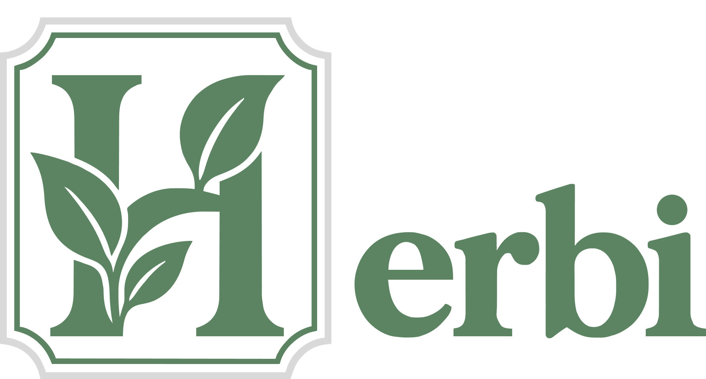
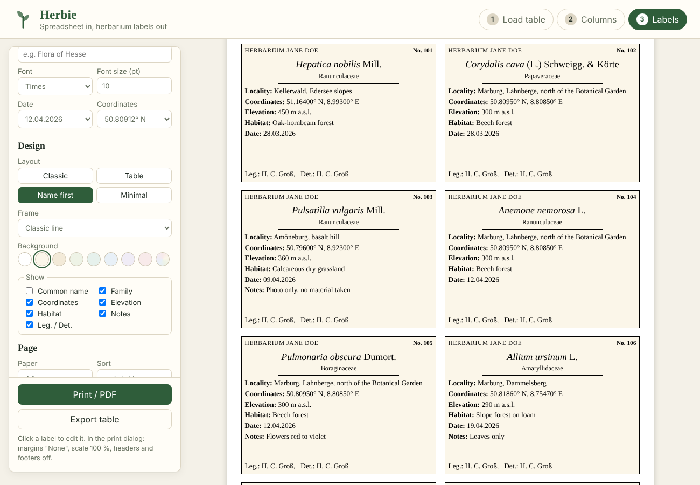
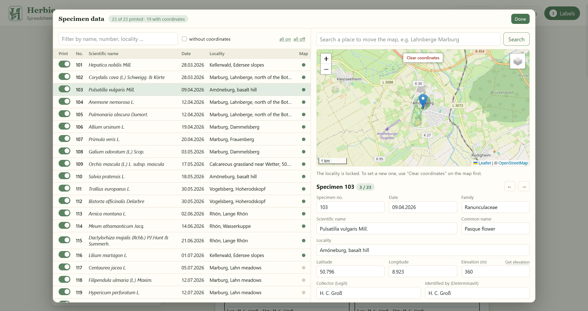

<p align="center"></p>

<p align="center"><i>Schedae ad Floram exsiccatam</i></p>

<h3 align="center">Herbarium labels have never been this easy.</h3>

<p align="center">Turn your collection spreadsheet into beautiful, print-ready herbarium labels in minutes. No installation, no account, and your data never leaves your browser.</p>

**Pin every find exactly.** Set the precise locality of each specimen with a click on the map and look up its elevation with one more click. Once set, a locality is locked, so nothing moves by accident.

**Make the labels yours, if you like.** Choose from ready-made layouts, frames, colours and paper textures, or build your own design in the label designer, logo included. Or simply keep the defaults.

**Three steps, that's it:**

1. **Load** your Excel or CSV table
2. **Choose** what to print
3. **Print** and put the labels on your sheets

<p align="center"><b><a href="https://christiang4.github.io/Herbie/">Open Herbie: christiang4.github.io/Herbie</a></b></p>



## Set the exact locality of each find, quickly and easily



Open **View / edit data** (or click a label) to see all specimens in a table next to an interactive map.

- **Click on the map** to set the locality of a specimen. OpenStreetMap, topographic and satellite maps are available, and the search moves the map to any place.
- **Locked once set:** a locality cannot be moved by accident. Use **Clear coordinates** to set a new one.
- **Elevation with one click**, from the Copernicus GLO-90 terrain model. The source is noted and exported.
- Coordinates already in your table, or written in the locality text (e.g. `Marburg, 50.8091, 8.8132`), are picked up automatically.
- Printed as decimal degrees, degrees and decimal minutes, or degrees, minutes and seconds.

## Features

- Reads Excel, OpenDocument and CSV files and recognises the columns automatically
- Labels in 11 languages, with correctly formatted scientific names
- Four ready-made layouts, frames, colours and paper textures
- Label designer for your own layout, logo included; designs can be exported and shared
- Choose which fields are printed and in which order, and add any extra column of your table
- Exports your table including the new coordinates and elevations
- Your session is kept in the browser, so you can continue later

## Privacy

Your table is processed locally and never uploaded. External requests are made only for:

| Purpose | Service | When |
|---|---|---|
| Excel library | cdn.sheetjs.com | on page load |
| Map tiles | OpenStreetMap, OpenTopoMap, Esri | when the map is shown |
| Place search | Nominatim (OpenStreetMap) | on click, with your search text |
| Elevation | Open-Meteo | on click, with the specimen's coordinates |

## Citation

If you use Herbie to prepare specimens for a publication, a collection report or a thesis, please cite it:

Groß, H. C. (2026). *Herbie: herbarium labels from spreadsheets* (Version 1.0.0) [Software]. https://github.com/ChristianG4/Herbie

```bibtex
@software{gross_herbie_2026,
  author  = {Groß, Hans Christian},
  title   = {Herbie: herbarium labels from spreadsheets},
  year    = {2026},
  version = {1.0.0},
  url     = {https://github.com/ChristianG4/Herbie}
}
```

GitHub also offers this citation under **Cite this repository** on the right.

## License

MIT © Hans Christian Groß
